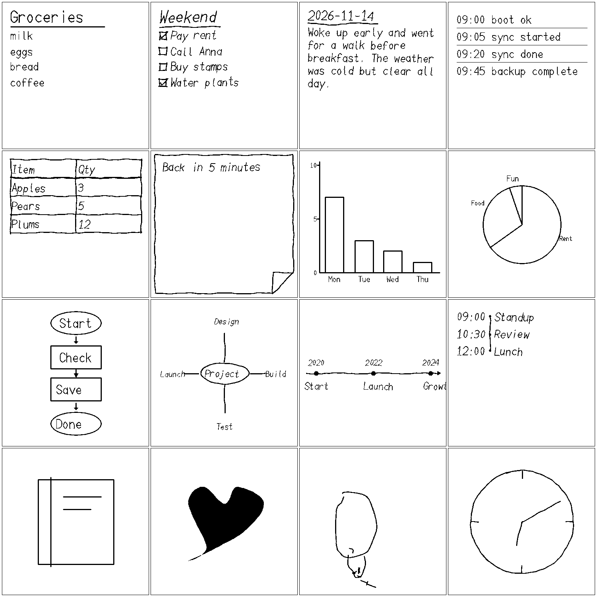
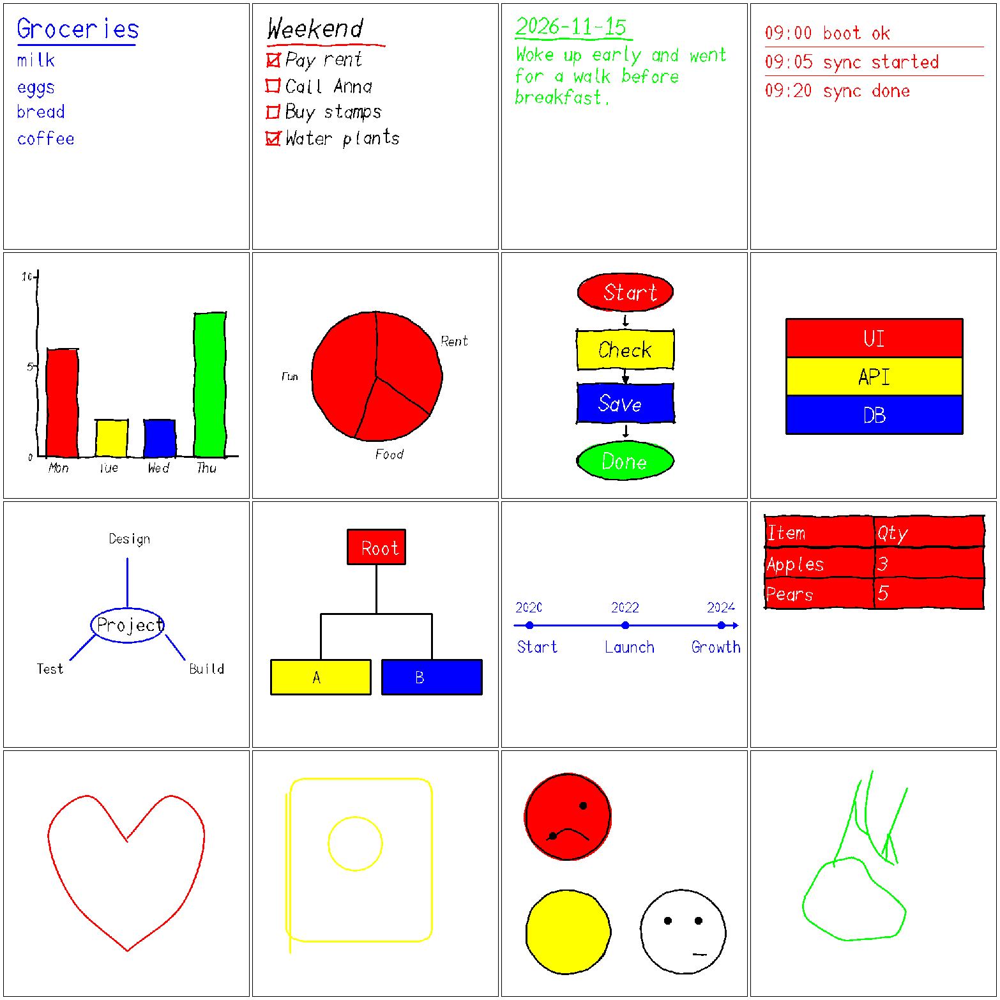
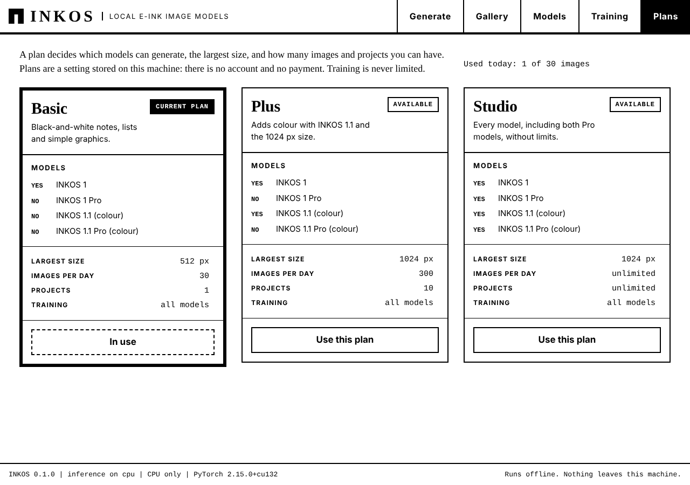
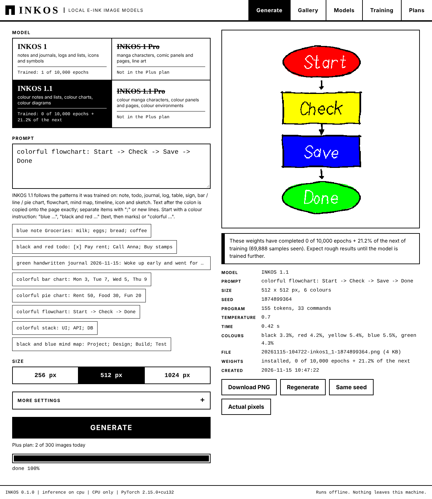

# INKOS

Four local image models for E-Ink screens: two draw **pure black and white**,
two draw in the **six-colour E-Ink palette**. All are trained from scratch
with PyTorch, run fully offline, and are driven from the command line or a
black-and-white HTML interface with three usage plans.

| | INKOS 1 | INKOS 1 Pro | INKOS 1.1 | INKOS 1.1 Pro |
| --- | --- | --- | --- | --- |
| Output | black and white, 1 bit | black and white, 1 bit | six colours | six colours |
| Made for | notes, journals, logs, lists, tables, icons, sketches, diagrams, charts | manga characters, comic panels and pages, line art, environments | the INKOS 1 subjects in colour | the INKOS 1 Pro subjects in flat colour |
| How it draws | a transformer writes a vector drawing program; a rasteriser renders it | a diffusion U-Net denoises a bitmap; a learned refiner upscales it | as INKOS 1, plus pen-colour tokens | as INKOS 1 Pro, one channel per colour |
| Parameters | 6.66 million | 57.55 million | 6.66 million | 57.69 million |
| Sizes | 256, 512, 1024 | 256 native, 512 and 1024 refined | 256, 512, 1024 | 256 native, 512 and 1024 refined |
| Training target | 10,000 epochs | 20,000 epochs | 10,000 epochs | 20,000 epochs |
| Trains on | a CPU or any GPU | a GPU (8 GB or more) | a CPU or any GPU | a GPU (8 GB or more) |
| Config | `configs/inkos1.yaml` | `configs/inkos1_pro.yaml` | `configs/inkos1_1.yaml` | `configs/inkos1_1_pro.yaml` |

Black-and-white models write 1-bit PNGs in which every pixel is exactly
`#000000` or `#FFFFFF`. Colour models write indexed PNGs whose palette holds
exactly six entries: black `#000000`, white `#FFFFFF`, red `#FF0000`, yellow
`#FFFF00`, blue `#0000FF` and green `#00FF00`, the pigments of current colour
E-Ink panels. No output ever contains a grey, a tint or an anti-aliased edge.

## What is trained and what is not

<!-- STATE:BEGIN -->
This repository was built and trained on one 4-core CPU with no GPU. The
numbers below are what was actually completed there, copied from the
trainer's status files:

| Model | Target | Completed | Weights in this repository |
| --- | --- | --- | --- |
| INKOS 1 | 10,000 epochs | **1 complete epoch** (330,000 samples, 10,313 steps, 2.5 hours of training) | installed in `models/inkos1/` |
| INKOS 1 Pro | 20,000 epochs | **0 complete epochs plus 6% of the next** (3,760 samples, 235 steps, 19.6 minutes of training) | not included |
| INKOS 1.1 | 10,000 epochs | **0 complete epochs plus 21% of the next** (69,888 samples, 2,184 steps, 41.5 minutes of training) | installed in `models/inkos1_1/` |
| INKOS 1.1 Pro | 20,000 epochs | **0 complete epochs plus 49% of the next** (2,912 samples, 182 steps, 14.4 minutes of training) | not included |

**INKOS 1** has seen each of its 330,000 training drawings exactly once. Measured on held-out prompts (`python -m inkos eval --model inkos1`): validation loss 1.50, 59% next-token accuracy, 97% pointer accuracy; 89% of freely sampled programs are valid even without the grammar mask; 90% of the requested text strings land on the page exactly.

* **Works:** notes, to-do lists, journals, logs, schedules, tables, flowcharts, mind maps and timelines come out right most of the time, with occasional slips such as a wrong checkbox or a label running off the edge (validation loss 0.05 to 0.15 on these families).
* **Approximate:** charts have the right structure and labels, but bar heights and pie shares do not follow the numbers yet (mean bar-height error 32 of 128 grid units in the evaluation sample).
* **Not learned yet:** icons and sketches (validation loss 1.88 and 2.88) still give scribbles or the wrong object. These families need many more passes over the data.



*Sixteen prompts (listed in `docs/samples/inkos1.json`) drawn with the installed one-epoch weights at 512 px. The last row shows the icon and sketch failures.*

**INKOS 1.1** started from INKOS 1's weights (1 epoch) and was then trained on its own colour data for 2,184 steps: 69,888 of 330,000 drawings, 21% of one epoch, so its own count is still 0 complete epochs. Measured the same way on its own colour validation set: loss 1.08 (not directly comparable with INKOS 1's figure: the colour set has fewer sketches, the hardest family), 70% next-token accuracy, 98% pointer accuracy, 92% of text strings exact. On colour: 98% of generated drawings use exactly the colours of their reference, and 46% of the pixels inked in either drawing carry the same colour in both (a strict measure that also drops wherever the shapes differ, not only where a colour is wrong).

* **Works:** the three colour forms on written pages and diagrams: one colour (`blue note ...`), two colours (`black and red todo ...` puts text in black and boxes and rules in red) and `colorful` flowcharts, stacks, trees and tables, with white lettering on dark fills.
* **Approximate:** bar heights still do not follow the numbers. A `colorful` pie is filled in a single colour, because the colour scheme it was trained on treats the pie's circle as one shape.
* **Not learned yet:** symbols, icons and sketches, as in INKOS 1. A `red heart` comes out right, but `colorful three stars` drew faces, and `yellow sun` and the tree sketch are not recognisable.



*Sixteen prompts (listed in `docs/samples/inkos1_1.json`) drawn with the installed INKOS 1.1 weights at 512 px.*

**INKOS 1 Pro** was only run long enough to prove the pipeline end to end: 235 steps, 3,760 of its 60,000 training images seen once (6% of one epoch). Its validation loss fell from 1.04 to 0.36, which at this stage only means it has learned how much of a page is ink: its samples are abstract black-and-white blobs, not drawings (edge density 0.031 against 0.110 for real training images).

**INKOS 1.1 Pro** was run the same way: 182 steps, 2,912 images (a 6,000-image colour set was prepared here instead of the full 60,000, so the epoch fraction shown above is of that smaller set). Its validation loss fell from 1.47 at step 70 to 0.77 at step 140, and at fixed noise it gives 86% of pixels the right colour, but like INKOS 1 Pro its samples are flat patches of colour, not drawings. Their colour mix is also off: no green at all and 20% yellow, against 8% green and 6% yellow in real training images.

No Pro weights are included. Both Pro models need a GPU and a long run before they draw anything recognisable, and they need real, licensed artwork before they can approach professional manga (see [DATA_LICENSES.md](DATA_LICENSES.md)).
<!-- STATE:END -->

The epoch counts above are **targets**. The trainer records what was really
completed in `runs/<model>/state.json`; the interface, `python -m inkos status`
and every exported weight file report that number and nothing else. An
untrained model refuses to generate instead of returning a placeholder.

## Quick start

```bash
pip install -r requirements.txt        # torch, numpy, pillow, pyyaml
```

```bash
python -m inkos doctor                 # hardware check for all four models
```

```bash
python -m inkos serve                  # http://localhost:8765
```

INKOS 1 and INKOS 1.1 ship with small trained weight files in `models/`, so
the interface can generate straight away. The two Pro models have to be
trained first. A new installation starts on the Basic plan, which includes
INKOS 1 only; see [Plans](#plans) to switch.

Generate from the command line:

```bash
python -m inkos generate --model inkos1 --prompt "bar chart: 3, 7, 5, 9" --size 512 --out chart.png
```

```bash
python -m inkos plan --set plus
```

```bash
python -m inkos generate --model inkos1_1 --prompt "colorful flowchart: Start -> Check -> Done" --out flow.png
```

## Plans

Three plans decide what the app will generate. They are defined in
`configs/plans.yaml` and can be renamed or changed there.

| Plan | Models | Largest size | Images per day | Projects |
| --- | --- | --- | --- | --- |
| Basic (default) | INKOS 1 | 512 px | 30 | 1 |
| Plus | INKOS 1, INKOS 1.1 | 1024 px | 300 | 10 |
| Studio | all four | 1024 px | unlimited | unlimited |

A plan is a setting stored on this machine (`settings.json`); the daily count
lives in `usage.json`. There are no accounts, license keys or payments:
switching is one tap on the Plans tab or `python -m inkos plan --set studio`.
Each plan has an optional `price` label in the config, empty by default,
which is only displayed. The local server and `python -m inkos generate`
both enforce the active plan. Training, evaluation and export are never
limited.



## Training

Training and inference are separate programs that only share files:

```
data/      prepared training sets            written by: data prepare / data import
runs/      checkpoints, metrics, state.json  written by: train
models/    installed inference weights       written by: export
projects/  your generated images             written by: generate / serve
```

### 1. Prepare data

```bash
python -m inkos data prepare --model inkos1
```

```bash
python -m inkos data prepare --model inkos1_pro
```

Use `inkos1_1` or `inkos1_1_pro` for the colour models.

INKOS 1 gets 330,000 drawings: procedural notes, charts, diagrams and symbols,
about 9,300 open-licensed stroke icons (MIT / ISC) and about 110,000
Quick, Draw! sketches (CC BY 4.0). The icon sets and sketches are downloaded
once; add `--offline` to use procedural data only. INKOS 1.1 gets the same
material with colour schemes applied. INKOS 1 Pro gets 60,000 procedurally
drawn manga images at 512 px with screentone; INKOS 1.1 Pro gets 60,000 drawn
in flat palette colours. Use `--count` for more or less. Sources and licenses
are listed in [DATA_LICENSES.md](DATA_LICENSES.md).

Add your own licensed artwork to INKOS 1 Pro or INKOS 1.1 Pro (captions come
from `.txt` files next to the images; for the colour model every pixel is
snapped to the nearest palette colour):

```bash
python -m inkos data import --model inkos1_pro --dir ~/my_art --license "own work"
```

Look at what a dataset contains:

```bash
python -m inkos data preview --model inkos1_pro --out sheet.png
```

### 2. Train

```bash
python -m inkos train --model inkos1
```

```bash
python -m inkos train --model inkos1_pro
```

* An **epoch** is one full pass over the prepared training set. Only complete
  passes are counted.
* A checkpoint is written at the end of every epoch, every 10 minutes inside
  an epoch, and when you stop the run (Ctrl-C, `python -m inkos stop --model
  ...`, or the Stop button). Running the same command again **resumes** from
  the exact batch it stopped at.
* If there is no checkpoint but `models/<model>/` holds installed weights (the
  situation right after cloning this repository), training **continues from
  those weights** and from their recorded epoch count. An export carries no
  optimiser state, so the optimiser starts cold with a fresh warm-up.
* INKOS 1.1 declares `train.init_from: inkos1`: when it has no checkpoint and
  no installed weights of its own, it starts from INKOS 1's installed weights
  (its six colour tokens start random) and its own epoch count starts at zero.
  Its status and manifest record where it started from.
* `--max-hours 8`, `--max-steps N` and `--until-epoch N` stop cleanly at a
  budget. `--fresh` discards the run and starts from random weights.
  `--device cuda:1` picks a device; on CUDA mixed precision is used
  automatically.
* `--set key=value` overrides any config value for one run, for example
  `--set train.batch_size=64`. Changing `model.*` changes the weight shapes,
  and the trainer refuses to resume a checkpoint that no longer fits.

Watch progress with `python -m inkos status`, the Training tab of the
interface, or `runs/<model>/train.log`. Each validation also writes sample
images to `runs/<model>/samples/`.

### 3. Install weights for inference

```bash
python -m inkos export --model inkos1
```

This copies the averaged (EMA) weights of the newest checkpoint to
`models/<model>/weights.pt` as float16 and writes a `manifest.json` that
records how much training they received. If nothing is installed, inference
falls back to the newest checkpoint and says so.

### How long will the targets take?

`python -m inkos doctor --bench` runs real optimisation steps and prints
measured throughput and the projected time to the target. For orientation,
on the 4-core CPU this project was built on:

<!-- BENCH:BEGIN -->
| Model | Measured training speed | One epoch | Full target |
| --- | --- | --- | --- |
| INKOS 1 | 45.83 samples/s (batch 32) | 2.0 hours for 330,000 samples | 10,000 epochs: 2.3 years |
| INKOS 1 Pro | 3.77 samples/s (batch 16) | 4.4 hours for 60,000 samples | 20,000 epochs: 10.1 years |
| INKOS 1.1 | 49.11 samples/s (batch 32) | 1.9 hours for 330,000 samples | 10,000 epochs: 2.1 years |
| INKOS 1.1 Pro | 3.34 samples/s (batch 16) | 5.0 hours for 60,000 samples | 20,000 epochs: 11.4 years |
<!-- BENCH:END -->

The targets are large: 10,000 epochs of INKOS 1 or INKOS 1.1 are 3.3 billion
training samples, and 20,000 epochs of either Pro model are 1.2 billion. They are out of
reach on a CPU; run the benchmark on your GPU for a real estimate. Lower
`target_epochs` or `data.count` in the config if you want a run that finishes
sooner; the cosine learning-rate schedule follows whatever target you set.

## Evaluation

```bash
python -m inkos eval --model inkos1
```

```bash
python -m inkos eval --model inkos1_pro --n 16
```

Writes `runs/<model>/eval/report.json` and a comparison sheet
(`samples.png`, generated image next to a reference).

INKOS 1 is scored on the held-out split with teacher forcing (loss,
perplexity, token and pointer accuracy per data family) and on free
generation: how often its programs are valid *without* the grammar mask, how
much of the requested text ends up on the page, whether bar charts have the
right number of bars at the right heights, and ink overlap with the
reference drawing.

INKOS 1 Pro is scored on denoising loss at four noise levels with fixed
noise, on how well the refiner restores reduced real images, and on how the
statistics of generated images (ink coverage, edge density, speckle) compare
with real ones.

The colour models use the same tools. INKOS 1.1 adds two colour scores: how
often a generated drawing uses exactly the colours of its reference, and the
share of inked pixels that have the reference colour. INKOS 1.1 Pro adds the
refiner's pixel accuracy and the colour mix of generated against real images.

## The interface

`python -m inkos serve` starts a local server (standard library only) and the
HTML interface in `web/`:



* **Generate**: model selector with each model's real training state, prompt
  box with example prompts, size selector, optional seed and sampling
  settings, a progress bar driven by the actual sampler, preview, PNG
  download, regenerate, repeat with the same seed.
* **Gallery**: every image is stored with its settings under
  `projects/<name>/`; browse, reuse a prompt, download or delete.
* **Models**: parameters, memory needs per size, hardware verdicts for this
  machine, the weights in use and their training record, data sources and
  licenses, and a button to install the newest checkpoint.
* **Training**: epochs completed against the target, samples seen, losses,
  measured speed and time to target, loss curve, latest validation samples,
  the trainer log, and Start / Resume / Stop.
* **Plans**: the three plans, what each includes, today's image count, and a
  button to switch. Models outside the active plan are shown struck through
  in the model selector and lead here.

The page itself uses two colours, no gradients, no shadows and no animation,
has 48 px touch targets, and only redraws what changed. The only other
colours on screen are the generated pictures and the palette swatches of the
colour models. It loads nothing from the network. By default the server listens on `127.0.0.1`; to use it from an
E-Ink tablet on the same network:

```bash
python -m inkos serve --host 0.0.0.0
```

## How the models work

### INKOS 1: a transformer that writes drawings

INKOS 1 never paints pixels. It writes **InkScript**, a small drawing
language on a 128 x 128 grid: polylines, smooth curves, outlines, filled
shapes, circles, rectangles, ellipses, text, plus pen state (stroke weight,
black or white ink, dashed, ruler-straight or hand-wobbled). A deterministic
rasteriser (`inkos/vector/render.py`) turns a program into a bitmap, which is
why one program gives the same picture at 256, 512 and 1024 pixels.

The network (`inkos/models/inkos1.py`) is an 8-layer, 256-wide prefix-LM
transformer. The prompt is read character by character with bidirectional
attention; the program is generated left to right with attention to the
prompt and to what has been written so far. Its output at every step is one
distribution over drawing tokens **and** over positions in the prompt (a
pointer head). A pair of pointers means "write this span of the prompt
here", so the words you type are copied onto the page exactly rather than
re-spelled by the network. Sampling runs with key/value caching and a grammar
mask, so every sampled program is well formed and renders.

Lettering is drawn with a single-stroke font made for this project
(`inkos/vector/font.py`). In hand mode every glyph gets seeded slant, size
and position jitter. The network decides what is written, where, how large
and in which style; the letter shapes come from the font, not from the
network.

Prompts it is trained on (a style word such as `handwritten`, `clean`,
`bold`, `thin` may come first):

```
note Groceries: milk; eggs; bread          todo: [x] Pay rent; Call Anna
journal 2026-11-14: Woke up early ...      log: 09:00 boot ok; 09:05 sync started
schedule: 09:00 Standup; 10:30 Review      table: Item, Qty; Apples, 3; Pears, 5
sign: Back in 5 minutes                    bar chart: Mon 3, Tue 7, Wed 5
line chart: 1, 4, 2, 8, 5                  pie chart: Rent 50, Food 30, Fun 20
scatter plot: 1 2, 3 5, 6 4                progress bar: 70%
flowchart: Start -> Check -> Done          mind map: Project; Design; Build; Test
tree: Root; A; B; C                        timeline: 2020 Start; 2022 Launch
venn diagram: Cats; Dogs                   cycle: Plan; Do; Check; Act
house icon      filled star      three stars      moon above a tree
clock at 3:40   sketch of a cat  doodle: bicycle
```

A multi-line prompt is read as one item per line. It is a small model
trained on these patterns, not a general language model: free-form sentences
outside them will not be understood.

### INKOS 1 Pro: diffusion over one-bit pixels

`inkos/models/inkos1_pro.py` holds three networks trained together:

* a character-level **text encoder** (4 layers, no pretrained weights);
* a **U-Net** that generates at 256 x 256. Each pixel is a bit, mapped to
  -1 / +1 and diffused as a real number ("analog bits"), with a
  rectified-flow schedule and self-conditioning. The network predicts the
  probability that each pixel is ink, so the loss is a binary cross-entropy
  and the denoised estimate is exact for binary data. Pixels are folded
  4 x 4 into channels, so the U-Net works on a 64 x 64 grid with
  self- and cross-attention at 16 x 16 and 8 x 8;
* a small convolutional **refiner** that doubles resolution and is trained on
  real pairs (each 512 px training image and its 2x reduction). It starts as
  plain pixel doubling and learns corrections on top; 1024 px applies it
  twice, in tiles, so memory stays flat.

Sampling uses deterministic Euler steps with classifier-free guidance on the
logits and ends with a hard threshold. Prompts are comma-separated tags, for
example `manga portrait, girl, long black hair, straight bangs, smiling,
sailor uniform, speed lines`.

The bundled training set is drawn by code (`inkos/data/manga_*.py`):
characters with varied hair, eyes, expressions and outfits, chibi figures,
eight kinds of environment, props, and multi-panel pages with one recurring
character, speech bubbles, sound effects and halftone screentone. It is
simple original artwork, good for learning line, tone and layout. It is not
professional manga, and a model trained only on it will not draw like one;
for that, import artwork you made or are licensed to use.

### INKOS 1.1 and INKOS 1.1 Pro: the same models in six colours

**INKOS 1.1** is the INKOS 1 network with six more tokens that set the pen
colour. The tokens are placed after the INKOS 1 vocabulary, so INKOS 1's
weights load into INKOS 1.1 unchanged and it starts with everything INKOS 1
already knows. Colour is asked for at the start of the prompt:

```
blue note Groceries: milk; eggs            everything in one colour
black and red todo: [x] Pay rent; ...      text in the first colour, marks in the second
colorful bar chart: Mon 3, Tue 7, Wed 5    shapes filled red, yellow, blue, green in turn
red heart      yellow sun      green sketch of a tree
```

In the colourful scheme outlines stay black and lettering on a dark fill is
written in white. The rasteriser works on palette indices and reduces its
supersampled canvas by majority vote, so colours are never mixed.

**INKOS 1.1 Pro** is the INKOS 1 Pro diffusion model with one channel per
palette colour instead of one ink bit. A pixel is diffused as a one-hot
vector, the network predicts a distribution over the six colours for every
pixel (cross-entropy loss), and the final picture is the most likely colour
of each pixel. Its training set is the procedural manga generator drawing in
flat colour: coloured hair, eyes and clothes, blue skies and seas, red shrine
gates, yellow moons, with captions that name the colours. Prompts start with
`color`, for example `color manga portrait, girl, long red hair, green eyes,
smiling, blue sailor uniform`.

## Project layout

```
configs/            the four model configurations and plans.yaml
inkos/
  cli.py            command line
  config.py         config loading, model fingerprint
  palette.py        the six-colour E-Ink palette
  plans.py          the three plans and their enforcement
  vector/           InkScript language, stroke font, rasteriser
  models/           inkos1.py (INKOS 1, 1.1), inkos1_pro.py (INKOS 1 Pro, 1.1 Pro)
  data/             generators, colour schemes, icon and sketch importers, dataset stores
  training/         trainer (checkpoints, resume, status) and per-model tasks
  evaluate.py       evaluation tools
  export.py         checkpoint -> installed weights
  engine.py         inference engine and model status
  hardware.py       hardware checks and benchmark
  server.py         local HTTP server
web/                interface (index.html, style.css, app.js)
tests/              test suite (pytest)
models/inkos1/      installed INKOS 1 weights and their manifest
models/inkos1_1/    installed INKOS 1.1 weights and their manifest
```

Run the tests with:

```bash
python -m pytest
```

They build tiny versions of all four models and run the full path: prepare,
train, stop, resume, export, generate at every size, evaluate, and the
server API.
