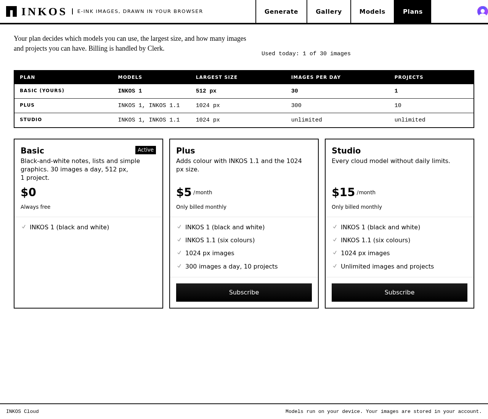

# INKOS Cloud

INKOS on Cloudflare Workers, with sign-in and billing by Clerk.

**Live (development instance):** https://inkos.playcore.workers.dev



## How it works

| Part | Where it runs | What it does |
| --- | --- | --- |
| Page and drawing engine | the user's browser | INKOS 1 and INKOS 1.1, ported from PyTorch to JavaScript (`public/engine/`), run in a Web Worker and write 1-bit or six-colour PNGs |
| Worker (`src/worker.js`) | Cloudflare Workers | serves the page, verifies Clerk session tokens, applies the plan, counts images, stores the gallery, hands out weights |
| D1 database `inkos` | Cloudflare | daily image counts, projects, gallery PNGs |
| KV namespace `inkos-weights` | Cloudflare | the two weight files (13.3 MB each) |
| Clerk application `INKOS` | Clerk | sign-in, user button, Clerk Billing plans and checkout |

The models run on the user's device because the Workers free plan allows
about 10 ms of CPU per request, far too little to run a transformer. A
picture takes about one second on a laptop. The two Pro models are
desktop-only: they are too heavy for a browser and have not been trained.

The browser engine is checked against PyTorch: from the same weights, greedy
decoding produces exactly the same tokens (`test/engine.test.mjs`).

## Plans and billing

The plans are the ones in `configs/plans.yaml`, sold through Clerk Billing:

| Plan | Clerk plan slug | Price (placeholder, test mode) | Models | Largest size | Images per day | Projects |
| --- | --- | --- | --- | --- | --- | --- |
| Basic | `free_user` | free | INKOS 1 | 512 px | 30 | 1 |
| Plus | `user_plus` | $5 / month | INKOS 1, INKOS 1.1 | 1024 px | 300 | 10 |
| Studio | `user_pro` | $15 / month | INKOS 1, INKOS 1.1 | 1024 px | unlimited | unlimited |

Prices are set in Clerk, not in this repository. The two paid plans reuse
the slugs Clerk's template created, so no plan had to be deleted.

The Worker reads the plan from Clerk's session token, a JWT whose `pla`
claim holds entries such as `u:user_plus`. It then refuses anything the plan
does not include:

- the weights of a model that is not in the plan;
- a size above the plan's limit;
- an image beyond the day's allowance, counted atomically in D1;
- a project beyond the plan's limit;
- a gallery upload larger than the plan allows.

No Clerk secret key is involved. Tokens are checked against the instance's
public signing keys, and their issuer, expiry and authorised party are
verified (`src/auth.js`).

Because the models run in the browser, a user who has downloaded weights
their plan includes could keep using them outside the app. The daily
allowance applies to everything generated through INKOS Cloud. Hard
enforcement would need inference on a server, which means Workers Paid with
Containers, or a GPU host.

## Deploying

From this directory, with Node 20+ and the Python environment of the main
project (needed only to convert the weights):

```bash
npm install
```

```bash
python3 build.py
```

`build.py` converts `models/inkos1*/weights.pt` into `public/weights/` and
bundles the page into `src/static.gen.js`. Both are generated, not committed.

First deployment only:

```bash
npx wrangler d1 create inkos
```

```bash
npx wrangler kv namespace create inkos-weights
```

Put the two ids into `wrangler.jsonc`, then:

```bash
npx wrangler d1 migrations apply inkos --remote
```

Every deployment:

```bash
./upload_weights.sh
```

```bash
npx wrangler deploy
```

Run `./upload_weights.sh` again whenever the weights change, and rebuild
before deploying.

### Clerk

1. Create an application and copy its publishable key into
   `CLERK_PUBLISHABLE_KEY` in `wrangler.jsonc`.
2. Turn on Billing for users. Create the plans with the slugs above and the
   features `inkos1`, `inkos1_1`, `size_1024`, `images_300`, `unlimited`.
   This repository's development instance was configured through Clerk's
   API with exactly these settings.
3. For real payments, create a production instance, connect Stripe under
   Billing, and use a domain you own. Then update the publishable key.

## Tests

```bash
python3 build.py && python3 test/make_fixtures.py
```

```bash
npm test
```

There are 16 tests in two groups:

- **Engine:** tokens identical to PyTorch, renders matching Python, PNG
  format, normalisation, word wrap.
- **Worker:** token forgery and expiry, issuer and site checks, plan
  mapping, weight gating, an atomic quota under concurrent requests,
  project limits, gallery privacy, static serving.

The Worker tests run on SQLite standing in for D1, with locally signed tokens
standing in for Clerk's.

## What was verified on the live deployment

Through Cloudflare's Browser Rendering API, a Clerk test user
(`inkos-e2e+clerk_test@example.com`, created through Clerk's admin API) was
signed in on https://inkos.playcore.workers.dev. Its real session token
carried `pla: "u:free_user"` and was accepted by the Worker, and as a Basic
user it got:

- **Refusals:** the INKOS 1.1 weights, an INKOS 1.1 picture and 1024 px were
  each refused with 403.
- **Generation:** the INKOS 1 weights downloaded from KV and a 512 px 1-bit
  PNG was drawn in the browser (about 1 s).
- **Records:** the image was counted (1 of 30) and saved to the gallery.

The pricing table renders the three plans from Clerk Billing.

**Not verified here:** paying for Plus or Studio through Clerk's checkout.
Clerk's bot protection rightly blocks automated browsers, so test an upgrade
by hand with Stripe's test card `4242 4242 4242 4242` while signed in.
